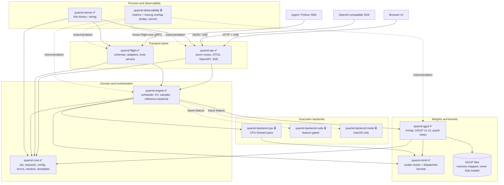
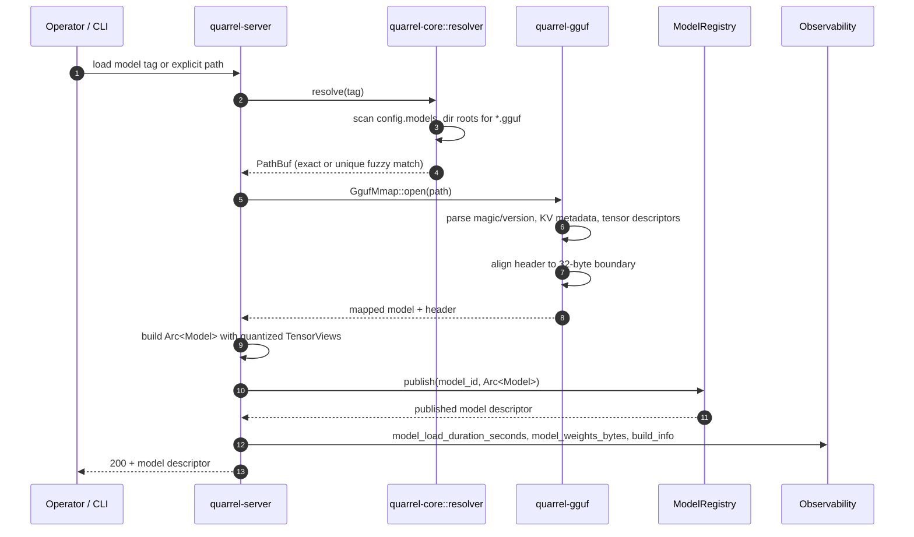
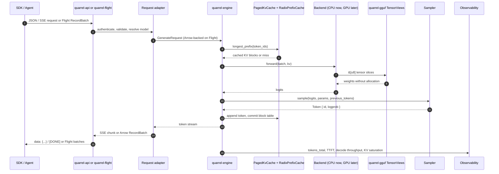
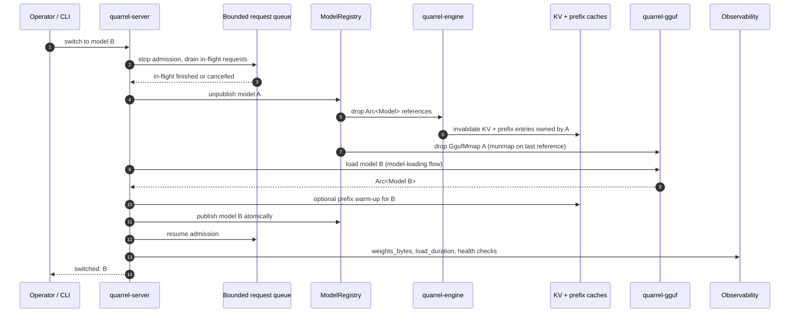

# Architecture

This document describes the Rust package graph and the runtime flows for loading a model, serving
inference and switching models. It is the implementation view of the goals in
[the roadmap](roadmap.md); CI enforcement lives in [gates](gates.md).

> **Status legend:** ✅ implemented in the current tree · 🚧 in progress in the current roadmap
> slice · ⏳ planned. The diagrams show the target shape; the table marks what exists today.

## 1. Component packages

Dependencies point **inward only**: transports depend on the engine, the engine depends on
GGUF/SIMD/core, and `quarrel-core` depends on no transport, backend or async runtime.

### 1.1 Package responsibilities

| Package | Responsibility | Status |
|---------|----------------|--------|
| `quarrel-core` | Typed IDs, request/response models, sampling params, config, chat templates, model resolver, non-exhaustive errors | ✅ |
| `quarrel-simd` | Scalar reference math and runtime-dispatched SIMD; the only home for hot-path `unsafe` | ✅ |
| `quarrel-gguf` | GGUF v1–v3 parser, `memmap2` ownership, typed tensor views, quant dequant/dot kernels | ✅ |
| `quarrel-engine` | Scheduler, paged KV cache, radix prefix cache, sampler, health audit, backend trait, reference backend | ✅ |
| `quarrel-flight` | Canonical Arrow schemas, zero-copy adapters, Flight service and IPC golden fixtures | ✅ |
| `quarrel-api` | OpenAI/Ollama DTOs, axum handlers, SSE/NDJSON streaming, generated OpenAPI document, embedded WebUI | ✅ |
| `quarrel-server` | CLI/config parsing and process lifecycle; delegates to the libraries above | ✅ |
| `quarrel-observability` | Metric constants, recorder, tracing layers and OTLP feature (currently living in `quarrel-server`) | ⏳ |
| `quarrel-backend-cpu` | Default execution backend | ⏳ |
| `quarrel-backend-cuda` / `quarrel-backend-metal` | Partial offload behind feature flags | ⏳ |

`quarrel-server` is intentionally thin: all behaviour lives in libraries so integration tests and
future binaries can reuse it without starting a process.

## 2. Model loading

A model is an immutable `Arc<Model>` published into a registry. Loading never copies weights into
the heap: `quarrel-gguf` owns a `memmap2::Mmap`, and `TensorView`s are byte slices into that mapping.

Loading failures are typed (`GgufError`, `CoreError::Resolver`) and mapped to OpenAI-shaped errors
on the HTTP plane. `/readyz` reports `model_loaded = true` only after the registry publish step.

### 2.1 Model discovery order

`quarrel-core::resolver` searches, in order:

1. explicit paths supplied by the caller;
2. `QUARREL_MODELS_DIR` (Helm mounts a PVC here);
3. `~/.cache/llmfit`, llama.cpp model directories, Hugging Face cache and Ollama tags.

Exact file-stem matches win; a case-insensitive substring match is accepted only when unique.

## 3. Inference

Two client planes converge on the same `GenerateRequest`. The Flight path stays Arrow-native; the
HTTP path converts JSON to Arrow once at the edge, then follows the same engine path.

Cancellation is propagated end to end: a dropped HTTP client or cancelled gRPC stream triggers a
`CancellationToken`, which rolls back the per-request KV state and releases its blocks. Every token
carries `request_id` and a monotonic `sequence`, so an Agent can retry `DoGet` and de-duplicate.

### 3.1 Zero-copy boundary

```mermaid
flowchart LR
    A["Agent RecordBatch"] -->|"FlightData frames, no re-encode"| B["Arrow Buffer / bytes::Bytes"]
    B -->|"Buffer::slice_with_length"| C["TensorView / KV bytes"]
    C -->|"&[u8] kernels"| D["logits"]
    D -->|"pre-sized PrimitiveBuilder"| E["response RecordBatch"]
    E -->|"FlightData stream"| F["Agent"]
```

Rules enforced by review, fuzzing and allocation benchmarks:

- no `serde_json` in the Flight hot path;
- no `to_data`, `iter().collect::<Vec<_>>()` or payload-sized allocations;
- output builders are pre-sized and pooled, then frozen into `Arc<RecordBatch>`;
- schema hash is reported in `quarrel_build_info{arrow_schema=...}` and Flight action metadata.

## 4. Switching models

Switching is an **atomic registry swap**, not an in-place mutation. In-flight requests finish or are
cancelled against the old immutable model; new requests see only the new one.

Why this shape:

- `Arc<Model>` means a long-running decode cannot observe a half-unloaded mapping.
- Bounded queues make drain time predictable; `--queue-depth` caps memory and latency.
- Per-model cache namespaces prevent a prefix hit on model A from being reused by model B.
- A failed load of B leaves A published and returns a typed error; there is no empty intermediate
  state.

## 5. Observability cross-cut

Metrics are declared once as constants and consumed by alerts and dashboards; `make metrics-check`
fails when code, rules or panels drift. Tracing spans carry `request_id`, `model`, `seq` and
`operation`, never prompt text at the default level. See [gates](gates.md) for the enforced checks
and roadmap §7 for the canonical metric names.

## 6. Relationship to the roadmap

| Roadmap phase | Packages touched |
|---------------|------------------|
| P1 | `quarrel-core`, fuzz harness |
| P2 | `quarrel-gguf`, `quarrel-simd` |
| P3 | `quarrel-engine` |
| P4 | `quarrel-flight` |
| P5 | `quarrel-api`, `quarrel-server` |
| P6 | backend crates, `quarrel-simd` |
| P7 | `quarrel-observability`, chart/dashboard assets |
| P8/P9 | gates, release artefacts |
